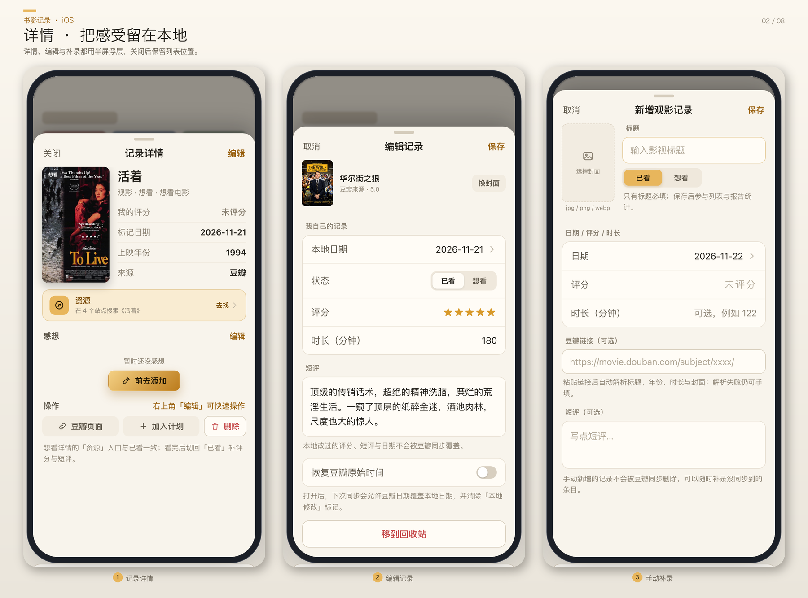
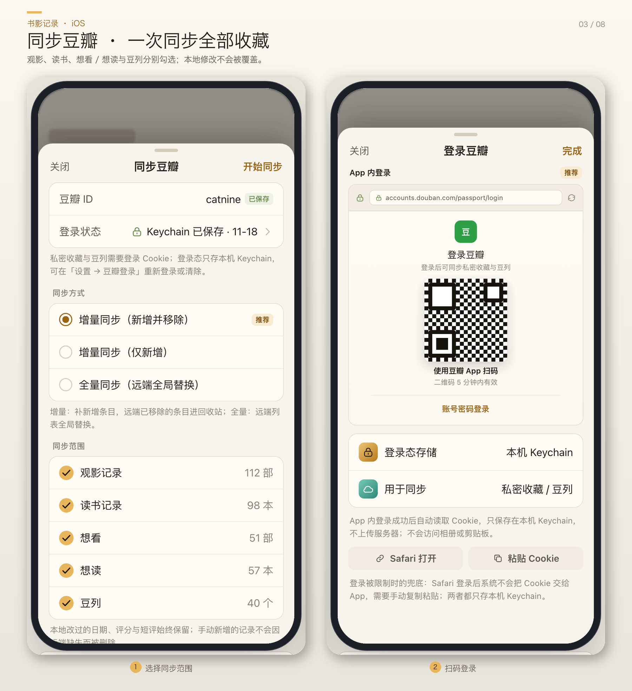
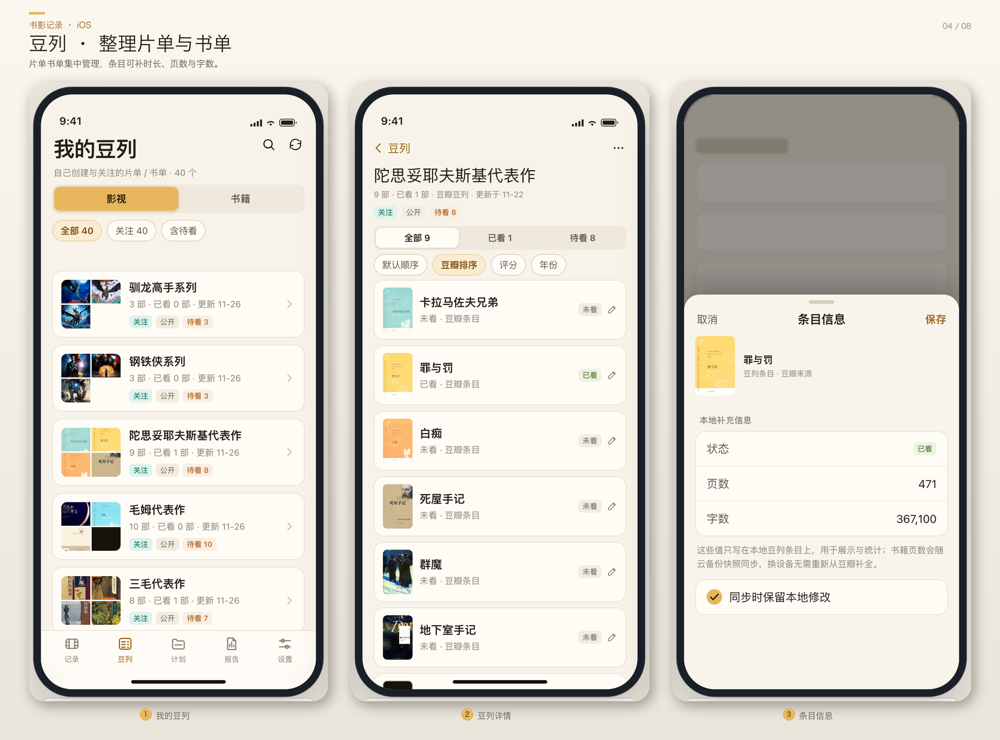
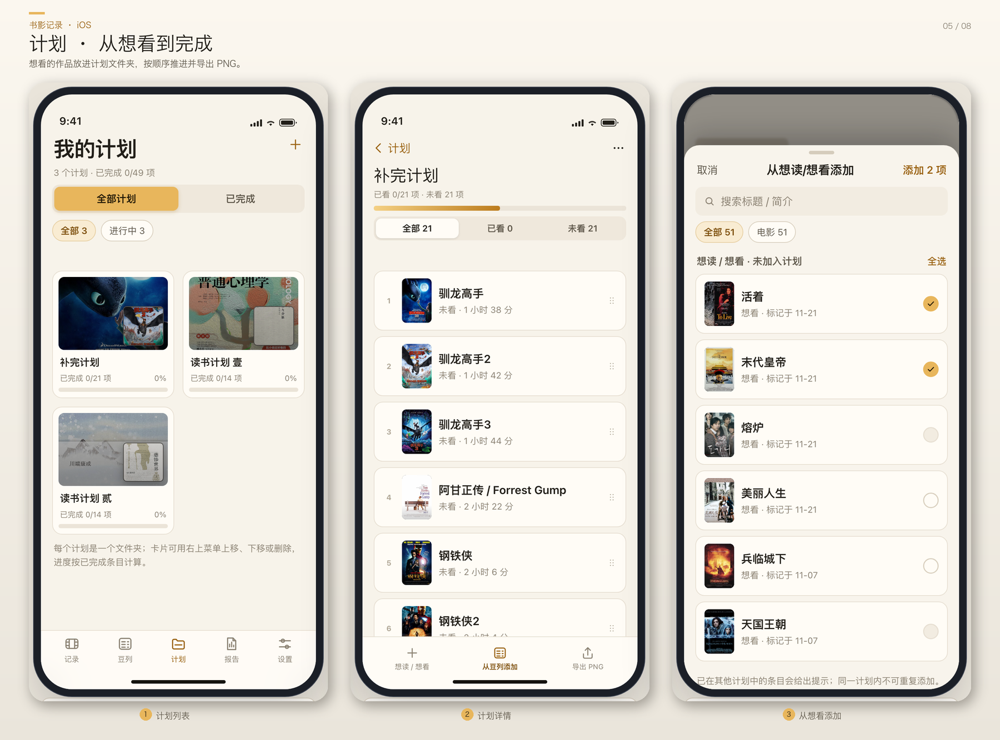
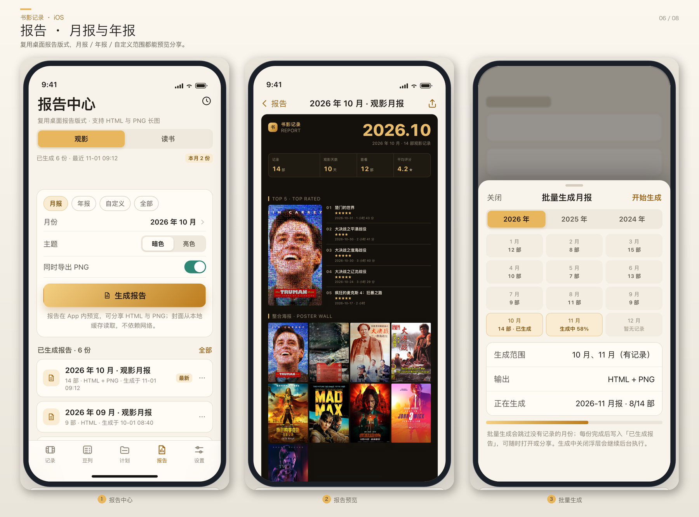
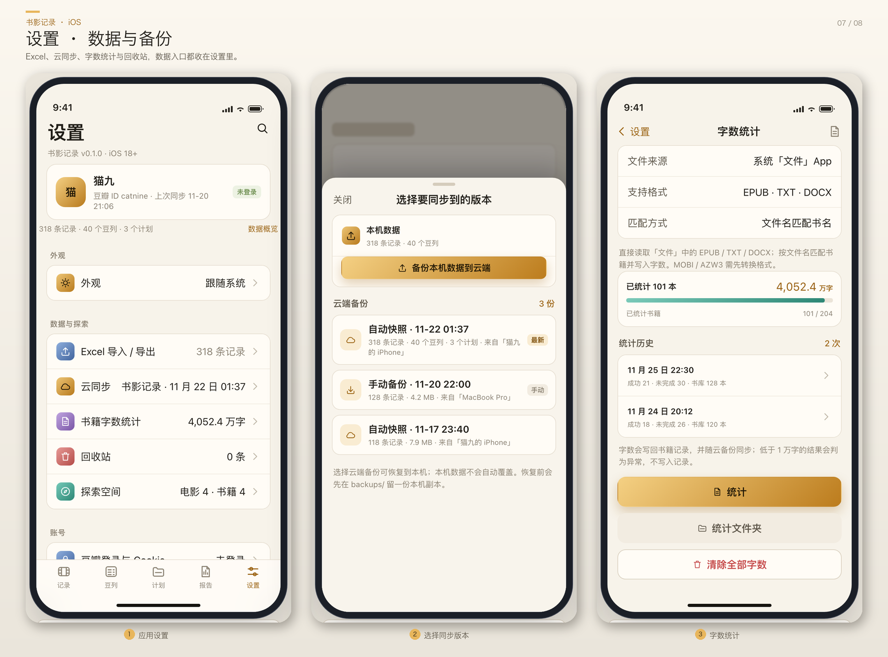
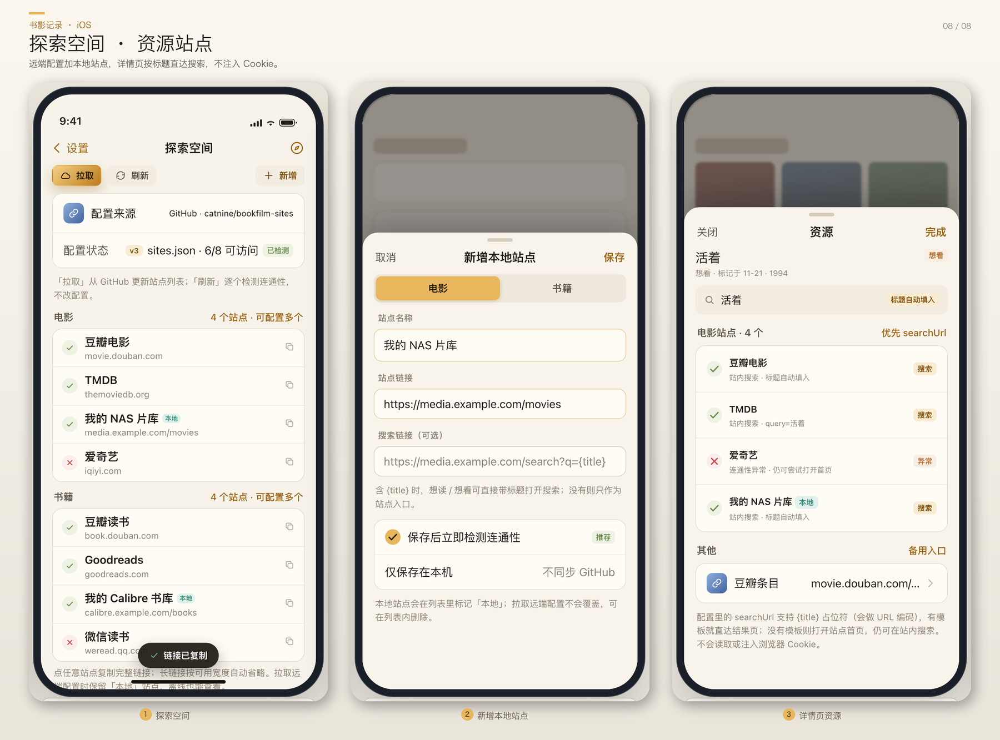

<div align="center">
  
  <h1>书影记录</h1>
  <p>把豆瓣上的观影与阅读，整理成一座属于自己的私人档案馆。</p>
  <p><code>iOS 18.6+</code> · SwiftUI · WebKit · JSON / SQLite 快照</p>
</div>

**书影记录 iOS** 是桌面端「书影记录」的 iPhone 原生版本：把豆瓣上的观影、读书、想看/想读、豆列与计划同步到本地，按本地生效日期浏览，并生成可归档、可分享的 HTML / PNG 报告。它沿用桌面端的数据模型与云同步协议，但不依赖桌面端运行。

## ✨ 它能做什么

- **同步豆瓣**：观影/读书、想看/想读、豆列与封面一次拉取到本地，支持增量 / 全量三种同步方式；登录使用 App 内 WKWebView，Cookie 只存本机 Keychain。
- **本地优先**：本地改过的日期、评分、短评不会被同步覆盖；手动新增的记录不会被同步删除。
- **沉浸浏览**：按生效日期分组的 3 列海报墙，支持已看/想看、观影/读书切换，搜索、日期跳转、详情与编辑。
- **豆列与计划**：整理片单书单，把想看的作品放进计划文件夹，逐个完成并导出 PNG。
- **报告**：沿用桌面端报告版式，在 WKWebView 内预览，支持 HTML 与 PNG 分享；月报、年报、自定义范围与批量生成。
- **云同步**：把整库导出为桌面端兼容的 SQLite 快照，写入用户选择的 iCloud Drive / 文件 App 目录；支持自动/手动快照、版本恢复与恢复前本机备份。
- **字数统计**：直接解析文件 App 中的 EPUB / TXT / DOCX，按文件名匹配书籍，统计结果随快照备份。
- **探索空间**：远端配置下发（GitHub，失败回退 Gitee），也支持本地站点；按标题带 `{title}` 直达各站点搜索，不注入 Cookie。
- **敢删**：记录、豆列、计划全部软删除；回收站可恢复或彻底删除，彻底删除会留标记，避免被豆瓣同步重新加回。
- **与桌面互通**：Excel 导入/导出、云快照和报告格式与桌面端保持一致。

## 📸 功能展示

### 记录 · 一屏浏览书影


观影 / 读书、已看 / 想看同页切换；按本地生效日期分组，保留评分、时长、页数与字数。

### 详情 · 把感受留在本地



点开海报看详情与感想；编辑、补录都用半屏浮层，关闭后保留列表滚动位置。已看与想看共用「资源」入口。

### 同步豆瓣 · 一次同步全部收藏



支持增量（新增并移除）、增量（仅新增）与全量同步；观影、读书、想看/想读、豆列分别勾选。扫码登录或粘贴 Cookie，登录态只存本机 Keychain。

### 豆列 · 整理片单与书单



集中管理自己创建和关注的片单书单；条目可以补时长、页数与字数，数值随云快照同步。

### 计划 · 从想看到完成



用文件夹管理想看的作品，从想读/想看或豆列添加，随时调整顺序；计划详情支持导出 PNG 分享。

### 报告 · 月报与年报



报告不重写 SwiftUI 图表：在 WKWebView 内加载与桌面端版式一致的 HTML，一屏看到年份、概览、TOP 5、海报墙、日历与短评；PNG 由 WebView 快照导出。

### 设置 · 数据与备份



外观、Excel 导入/导出、云同步、书籍字数、回收站与探索空间都收在设置里。云同步恢复前会先写一份本机备份，不会静默覆盖当前数据。

### 探索空间 · 资源站点



资源站点由远端配置下发，也可以添加自己的本地站点；拉取不覆盖本地项，支持连通性检测与点击复制链接。记录详情页的「资源」会按标题带 `{title}` 直达各站点搜索。

## 🛫 快速开始

### 环境

- macOS + Xcode 27.2
- iOS 18.6+ 模拟器或真机
- 无需 CocoaPods / 第三方运行时依赖

### 运行

```bash
open BookFilmJournal-iOS.xcodeproj
```

选择 `BookFilmJournal-iOS` scheme 和 iPhone 模拟器后运行。

命令行构建：

```bash
xcodebuild \
  -project BookFilmJournal-iOS.xcodeproj \
  -scheme BookFilmJournal-iOS \
  -destination 'platform=iOS Simulator,name=iPhone 17 Pro' \
  build
```

### 首次使用

1. 在「记录」页右上角点「同步」，填写豆瓣 ID；私密收藏和豆列需要扫码登录或粘贴 Cookie。
2. 选择同步方式与范围，开始同步。
3. 在「设置 → 云同步」选择 iCloud Drive 或文件 App 中的同步目录，建立第一份快照。
4. 在「设置 → 书籍字数统计」选择文件 App 中的书库文件夹，统计 EPUB / TXT / DOCX。

## ☁️ 与桌面端的数据互通

### 云同步

iOS 与桌面端共用同一套同步目录协议：

```text
<用户选择的目录>/书影记录/
├── douban_trace_20261126_143000_ab12_auto.db
├── douban_trace_20261126_143000_ab12_auto.db.ios.json
├── latest.json
└── devices.json
```

- iOS 本地使用 JSON；备份时导出为桌面端可读取的 SQLite `.db` 快照。
- 快照包含记录、豆列、计划、书籍字数/页数、影片时长、换源忽略与彻底删除标记。
- iOS 额外写入 `.db.ios.json` sidecar，保留时长、页数、年份、上映日期、封面等展示字段。
- 不使用 CloudKit / OneDrive SDK；依赖系统文件同步，不做条目级冲突合并。
- 恢复前自动写入本机备份，保留最近 5 份。

完整字段、命名和恢复规则见：[`docs/云同步与备份协议-iOS.md`](docs/云同步与备份协议-iOS.md)。

### Excel 与报告

- Excel 导入/导出与桌面端字段兼容，可搬移记录、豆列、计划与回收站标记。
- 报告沿用桌面端的字段与版式；iOS 负责生成 HTML、WKWebView 预览与 PNG 快照，避免两端版式漂移。
- 桌面端说明见 `BookFilmJournal` 仓库的 `README.md`。

## 🧭 探索空间配置

配置文件：`BookFilmJournal-iOS/Config/ExploreSources.json`。资源构建阶段会把它复制到 App Bundle，修改后重新编译生效。

```json
{
  "sources": [
    {
      "id": "github",
      "name": "GitHub",
      "description": "优先从 GitHub 拉取远端站点配置。",
      "url": "https://raw.githubusercontent.com/catnine/bookfilm-sites/main/sites.json"
    },
    {
      "id": "gitee",
      "name": "Gitee",
      "description": "GitHub 拉取失败时回退到 Gitee 镜像。",
      "url": "https://gitee.com/catnine/bookfilm-sites/raw/main/sites.json"
    }
  ]
}
```

- 按 `sources` 数组顺序尝试拉取，默认 **GitHub → Gitee**。
- 某个源请求失败、超时或返回内容无法解析时，自动尝试下一个源。
- 全部源失败时保留本地配置，并提示「拉取失败，已保留本地配置」。
- 成功拉取后会替换远端站点，但保留本地站点。
- `name` 用于展示配置来源；`description` 用于说明；`url` 指向符合 `sites.json` 结构的配置。
- 如果 Gitee 镜像仓库地址不同，直接修改 `url`，不需要改 Swift 代码。

## 🗂 数据存储

iOS 沙盒内：

```text
Library/Application Support/BookFilmJournal/
├── library.json                 # 本地 JSON 数据库
├── Covers/                      # 本地封面缓存
└── backups/                     # 恢复前本机 JSON 备份（最多 5 份）
```

`library.json` 保存记录、豆列、计划、报告索引、换源忽略与彻底删除标记。封面图片单独存放；云快照只携带必要的封面数据，不把整个缓存目录放进同步目录。

模拟器数据可在 Xcode 的 Devices and Simulators 中查看容器；真机数据随 App 卸载删除，重要数据请先建立云快照或导出 Excel。

## 🧩 项目结构

```text
BookFilmJournal-iOS/
├── BookFilmJournal-iOS/
│   ├── App/                     # App 入口、路由
│   ├── Features/                # 记录、豆列、计划、报告、设置
│   ├── Models/                  # JSON 模型与 LibraryStore
│   ├── Services/                # 豆瓣、云同步、Excel、字数、报告导出
│   ├── Design/                  # 主题、海报、分享组件
│   ├── L10n/                    # 本地化生成代码
│   └── Config/                  # 探索空间配置源
├── docs/
│   ├── images/                  # README 引导图
│   └── 云同步与备份协议-iOS.md
├── prototype/                   # HTML 高保真原型（29 屏）
├── tools/make_guide_images.py   # 从原型截图生成 README 引导图
└── Scripts/gen_l10n.py          # Localizable.strings → L10n.swift
```

## 🛠 开发

### 本地化

修改 `BookFilmJournal-iOS/zh-Hans.lproj/Localizable.strings` 后生成：

```bash
python3 Scripts/gen_l10n.py
```

### 原型

```bash
python3 prototype/build.py
open prototype/index.html
./prototype/capture.sh
```

原型说明见 [`prototype/README.md`](prototype/README.md)；五版移动端报告样式与对比图在 `prototype/report-styles/`。

### README 引导图

引导图由 `prototype/shots/` 下的分组截图裁切、排版生成，输出到 `docs/images/`：

```bash
python3 -m pip install pillow
python3 tools/make_guide_images.py
```

修改原型后，先运行 `./prototype/capture.sh`，再重新生成引导图。

## ❓ 常见问题

**同步返回 403 / 418 / 429？**
豆瓣可能对高频访问限流；稍后重试，避免频繁全量同步。私密收藏需要登录 Cookie。

**Cookie 保存在哪里？**
登录成功后 Cookie 存在本机 Keychain，不上传服务器；可在「设置 → 豆瓣登录」重新登录或清除。

**iCloud 同步需要登录账号吗？**
需要先在系统层登录 iCloud，并在「文件」App 中启用 iCloud Drive；App 不接入 CloudKit，也不支持在 App 内登录 iCloud。

**云同步会覆盖本机数据吗？**
不会静默覆盖。恢复前会先写入 `backups/` 本机备份，并列出云端快照类型、时间、来源设备与条数，由你选择恢复。

**字数统计为什么有书籍被跳过？**
当前只直接解析 EPUB / TXT / DOCX；MOBI / AZW3 需先转换。低于 1 万字的结果视为解析异常，不写入统计。

**报告 PNG 打不开或版式异常？**
先确认报告 HTML 能在 App 内正常预览；PNG 由 WKWebView 快照生成，超长报告需要分段导出。

**为什么没有小组件 / 通知 / 多用户？**
当前版本聚焦「同步 → 整理 → 计划 → 报告 → 备份」闭环，沿用桌面端单豆瓣 ID 模型，不做账户体系。

## ✅ 当前边界

- 不做账户 / 多用户；沿用桌面端单豆瓣 ID。
- 不做 CloudKit；云同步是整库 SQLite 快照 + 用户选择的文件目录。
- 不做网页内嵌搜索；只通过 `searchUrl` 的 `{title}` 跳系统浏览器。
- 不引入 Calibre；iOS 只做 EPUB / TXT / DOCX 原生统计。
- 报告不重写 SwiftUI 版式；统一走 HTML + WKWebView。
