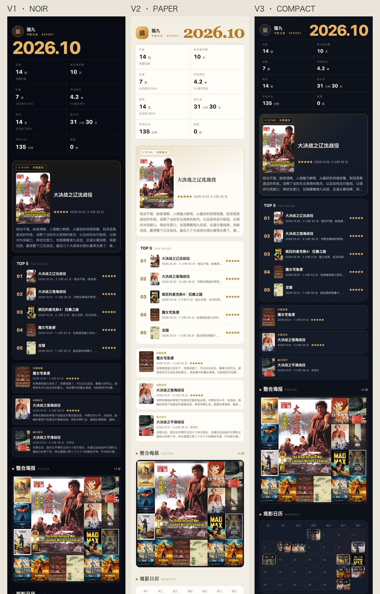
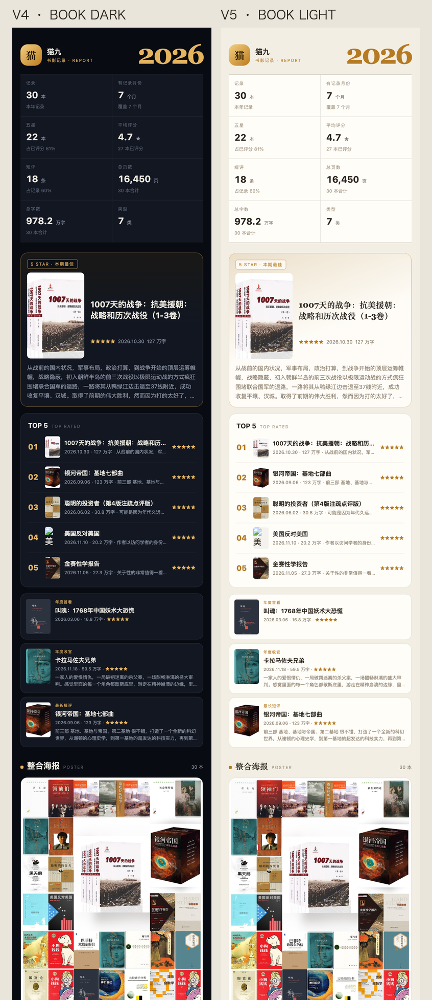

# 移动端报告样式方案

基于桌面端生成文件 `movie_month_2026-10.html`，用同一份电影内容做了 3 个 390pt 宽的移动端样式案例，并补了 2 个书籍年报案例，仅调整 CSS，不改数据与结构。

顶部品牌位已按设置页使用「猫九 / 猫」；接入 App 时头像读取 `bookfilm.doubanAvatarURL`，读取失败则回退品牌字。



## 方案

| 方案 | 文件 | 方向 | 适合 |
| --- | --- | --- | --- |
| V1 · Noir | `v1-noir.html` | 深色、桌面延续；2 列指标、横排最佳、紧凑 TOP 5 | 默认深色，和 App / 桌面端最一致 |
| V2 · Paper | `v2-paper.html` | 暖白纸、宋体数字与大标题；更适合长时间阅读 | 亮色主题、导出分享 |
| V3 · Compact | `v3-compact.html` | 深色高密度；指标子说明收起，短评更紧凑 | 记录很多、优先减少滚动时 |
| V4 · Book Dark | `v4-book-dark.html` | 书籍年报深色版；月度日历两列展开 | 书籍年度报告 |
| V5 · Book Light | `v5-book-light.html` | 书籍年报亮色版；同一布局的纸感配色 | 书籍年度报告分享 |

完整长图：`shots/v1-noir.png`、`shots/v2-paper.png`、`shots/v3-compact.png`、`shots/v4-book-dark.png`、`shots/v5-book-light.png`。



## 建议

**电影默认 V1 · Noir，亮色 V2 · Paper；书籍年报用 V4 · Book Dark / V5 · Book Light。全部共用 V2 的顶部品牌、字体和间距体系。**

原因：

- V1 延续桌面端的深色档案馆气质，和 App 默认深色一致；顶部品牌/字体/间距已统一到 V2。
- V2 的纸感亮色比直接把桌面深色改亮更耐读；保留大数字和宋体标题，适合报告分享。
- V4 / V5 在 V2 的布局上补书籍年报的两列月度日历，深色与亮色各自保持一致。
- V3 的信息密度过高，TOP 5 和短评字号偏小，不建议作为默认；可作为「紧凑模式」后续再加。

## 查看

```bash
open prototype/report-styles/v1-noir.html
open prototype/report-styles/v2-paper.html
open prototype/report-styles/v3-compact.html
open prototype/report-styles/v4-book-dark.html
open prototype/report-styles/v5-book-light.html
```

当前只出样，不改 `ReportExportService`。确认方案后再把对应 CSS 接入 iOS 报告 HTML。
